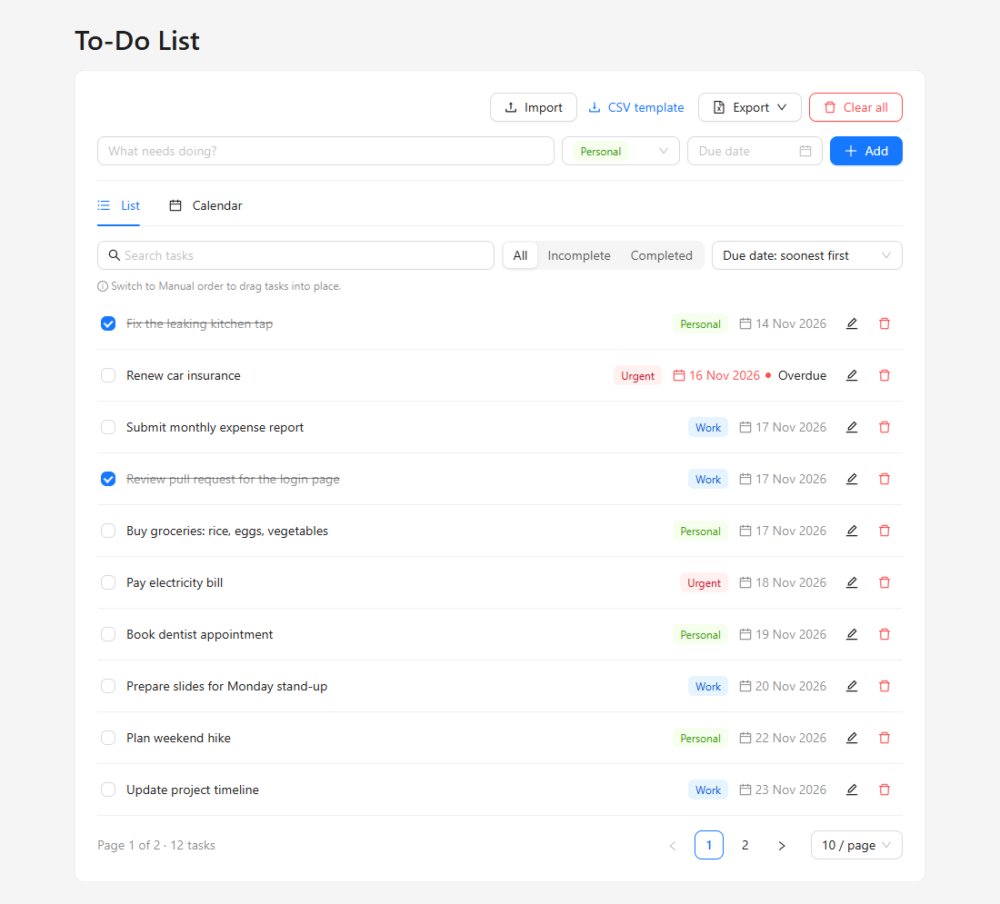
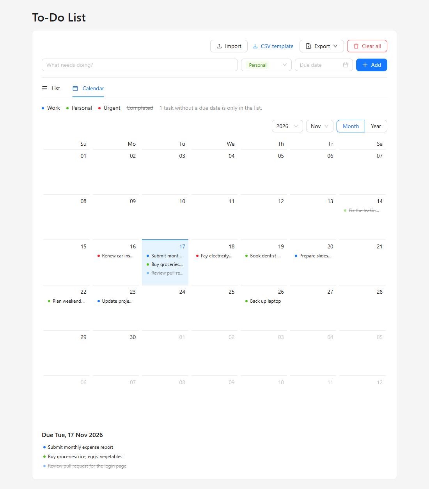
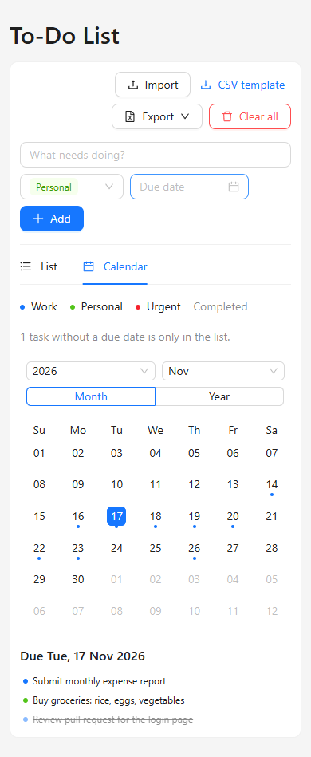

# WhatIf To-Do

A to-do list app built with **Next.js** and **Ant Design**: add, edit, search, filter, sort and page through tasks. It also has CSV/Excel import, Excel export, a calendar view and drag-and-drop ordering. Tasks are saved in the browser, so there's no account and no server.

**Live demo:** _TODO: add the Vercel URL_



| Calendar | Mobile |
|---|---|
|  |  |

On the first visit the app adds 12 sample tasks so every feature has something to show. **Clear all** removes them, and **Load sample tasks** on the empty list brings them back.

## Features

### Required

- [x] List, add, edit and delete tasks. Deleting asks for confirmation first.
- [x] Mark tasks complete or incomplete.
- [x] A due date per task. Overdue tasks are flagged in red.
- [x] Categories (Work, Personal, Urgent), chosen from a dropdown, each with a consistent colour.
- [x] Pagination with 5, 10, 15 or 20 tasks per page, previous/next and page numbers, and "Page X of Y · N tasks". The page size is remembered.
- [x] Search by keyword (case-insensitive, 200 ms debounce), filter by status (all, incomplete, completed), and sort by due date in either direction. Tasks with no due date always go last.
- [x] Saved in localStorage, so tasks survive reloads, browser restarts and stay in sync across open tabs.
- [x] Bulk import from `.csv`, `.xlsx` or `.xls`, with a preview of valid, skipped and changed rows before anything is added.
- [x] Export to `.xlsx`: either all tasks, or the current view (filtered and sorted, across every page).

### Optional extras (both done)

- [x] **Calendar view**: tasks on their due dates, colour-coded by category, with a legend. Click a task to edit it; "+N more" lists busy days in full. Phones get a compact month view with the selected day's tasks listed below.
- [x] **Drag-and-drop reordering** in *Manual order*, by mouse, touch or keyboard (focus the handle, press Space, use the arrow keys, then Space to drop).

## Getting started

Requires **Node.js 20.9 or later**.

```bash
npm install
npm run dev      # http://localhost:3000
npm test         # unit and hook tests (Vitest)
npm run build    # production build
```

## Tech stack

| | Choice | Why |
|---|---|---|
| Framework | Next.js 16 (App Router) + TypeScript | Current `create-next-app` defaults; the types catch mistakes early. |
| UI | Ant Design 6 | Ships Pagination, DatePicker, Upload, Modal, Form and Calendar, so it covers nearly every requirement without extra libraries. |
| Dates | dayjs | Already used by antd's DatePicker. |
| State | `useTodos` hook (`useReducer` + context) | Follows the structure suggested in the brief; Redux would be overkill. |
| Import / export | SheetJS (`xlsx`), from the official SheetJS CDN | One library reads CSV and Excel and writes Excel. The npm-registry copy is old and unmaintained. |
| Frozen header | `fflate` | The free SheetJS edition can't freeze panes, so the exported file is patched after writing (about 8 KB). |
| Drag and drop | `@hello-pangea/dnd` | The maintained fork of `react-beautiful-dnd`, with the same API. The original is deprecated by Atlassian and doesn't support React 18+ or Strict Mode. |
| Tests | Vitest + React Testing Library | Fast tests for the list pipeline, import parser, storage and hook. |

SheetJS and fflate load only when you import or export, so they add nothing to the first page load.

## Storage: what I compared

| Option | Pros | Cons | Verdict |
|---|---|---|---|
| **localStorage** | Synchronous, simple, works everywhere, about 5 MB (thousands of tasks) | Strings only; blocks the main thread on very large data | ✅ **Used**, behind a small adapter |
| IndexedDB (`idb` / Dexie) | Large capacity, async, indexed queries | Much more code and setup | The upgrade path for very large lists |
| sessionStorage | Simple | Cleared when the tab closes, so it fails the requirement | ❌ |
| Cookies | Readable by the server | About 4 KB, and sent with every request | ❌ |

How [`lib/storage.ts`](src/lib/storage.ts) handles the edge cases:

- **Hydration guard.** localStorage doesn't exist during server rendering. Tasks load in an effect, a skeleton shows until then, and nothing is saved until loading has finished. Without that last part, the first render would overwrite saved tasks with an empty list, the most common bug in Next.js to-do apps.
- **Validation and migration.** Saved data has a schema version. On load, every task is checked: fixable fields are repaired (an unknown category becomes Personal, an invalid date is cleared), and broken or duplicate tasks are dropped with a notice.
- **Nothing is lost silently.** If the saved data can't be read at all, it's copied to a backup key before the app starts fresh, and the notice says where.
- **Failures don't crash the app.** A full or blocked storage shows a notification instead.
- **Cross-tab sync** through the `storage` event. Identical writes are skipped, so two tabs don't echo each other.

## Import format

Download the template: [`sample-import.csv`](public/sample-import.csv) (also linked next to the Import button).

| Column | Required | Also accepted as | Rules |
|---|---|---|---|
| description | ✅ | task, title, name | Trimmed; 1–200 characters. Rows without one are skipped. |
| category | | type | Work, Personal or Urgent, any case. Anything else becomes Personal, with a warning. |
| dueDate | | due, due date, deadline | `YYYY-MM-DD`, `DD/MM/YYYY`, or a real Excel date cell. Invalid dates are cleared, with a warning. |
| completed | | done, status | true/false, yes/no, 1/0, completed/pending. Defaults to false. |

Header names are matched regardless of case, spacing and column order. Edge cases handled:

- A UTF-8 byte-order mark, CRLF line endings, quoted commas, and blank or trailing rows.
- **Excel dates are stored as serial numbers.** They're converted directly, without going through JavaScript `Date`, so the result doesn't depend on the time zone. The 1904 date system is supported.
- **`05/12/2026` means 5 December.** CSVs are read as plain text because SheetJS's type guessing would read it as 12 May (US order).
- A 2,000-row and 5 MB limit, and clear errors for unsupported or corrupt files.
- Imported tasks get new ids and are added after the existing ones.

**Round trip:** the export uses the same column names (Description, Category, Due Date, Status, plus Created and Updated, which are ignored on import), so an exported file imports back unchanged. A test checks this.

## Design decisions

- **Pure logic, thin components.** Search → status filter → sort → paginate is one pipeline of plain functions in [`lib/query.ts`](src/lib/query.ts). Import parsing, export building, reordering and storage live in `lib/` too, with no React, so they're easy to test and to read.
- **Date-only strings.** Due dates are stored as `YYYY-MM-DD`. They sort correctly as text, serialise cleanly and never shift a day across time zones.
- **Page rules.** The page resets to 1 when the search, filter, sort or page size changes. Deleting the last task on a page moves you back a page instead of showing a blank one. The label never says "Page 1 of 0".
- **Drag-and-drop only in Manual order.** Dragging can't mean anything when the list is sorted by date, so the handles appear only in *Manual order*, with a hint otherwise. When a search or filter is active, or there are several pages, a drag reorders only the visible tasks among themselves: they swap their positions, and tasks hidden by the filter keep theirs.
- **antd's built-in Calendar** instead of `react-big-calendar`: no extra dependency, and it matches the rest of the UI. Tasks are grouped by date once per change, so each cell is a lookup rather than a scan of every task.
- **Custom list rows.** antd 6 deprecates `List` (it logs a warning), and its replacement `Listy` is built for virtual scrolling, which conflicts with drag-and-drop. The rows are plain `<ul>`/`<li>` styled with antd's theme tokens.
- **Cache Components is off** in `next.config.ts`. antd's CSS-in-JS registry calls `Math.random()` during render, which Cache Components rejects. The app is client-side by nature, so nothing is lost.

## Project structure

```
src/
├── app/
│   ├── layout.tsx          # AntdRegistry + ConfigProvider (theme) + App
│   ├── page.tsx            # toolbar, add form, List | Calendar tabs
│   └── globals.css
├── components/
│   ├── AddTodo.tsx         # add form (description, category, due date)
│   ├── EditTodo.tsx        # same fields in a modal
│   ├── TodoFormFields.tsx  # fields shared by both forms
│   ├── TodoList.tsx        # rows, drag-and-drop, pagination, empty states
│   ├── TodoItem.tsx        # one row: checkbox, text, tag, due date, actions
│   ├── Filters.tsx         # search, status, sort
│   ├── Calendar.tsx        # month calendar with category-coloured tasks
│   ├── ImportTodos.tsx     # upload → preview → confirm
│   └── ExportButton.tsx    # all tasks / current view
├── hooks/useTodos.ts       # reducer, actions, persistence, derived view
├── lib/
│   ├── query.ts            # search → filter → sort → paginate; calendar grouping
│   ├── storage.ts          # load / save / migrate / cross-tab sync
│   ├── importer.ts         # parse and validate CSV/Excel rows
│   ├── exporter.ts         # build the workbook, freeze the header
│   ├── reorder.ts          # drag-and-drop order maths
│   ├── validation.ts       # task rules, date helpers
│   ├── categories.ts       # category list + colour map
│   ├── demo.ts             # first-visit sample tasks
│   └── id.ts
└── types/todo.ts
__tests__/                  # query, importer (+ export round trip), storage, reorder, useTodos
public/sample-import.csv
```

## What I'd do next

- **IndexedDB** (via Dexie) for very large lists and imports.
- **Backend sync and user accounts**, so tasks follow you across devices.
- **End-to-end tests with Playwright** covering import, drag-and-drop and the calendar in a real browser.
- **Undo** for delete and Clear all, as a toast with an Undo button.
